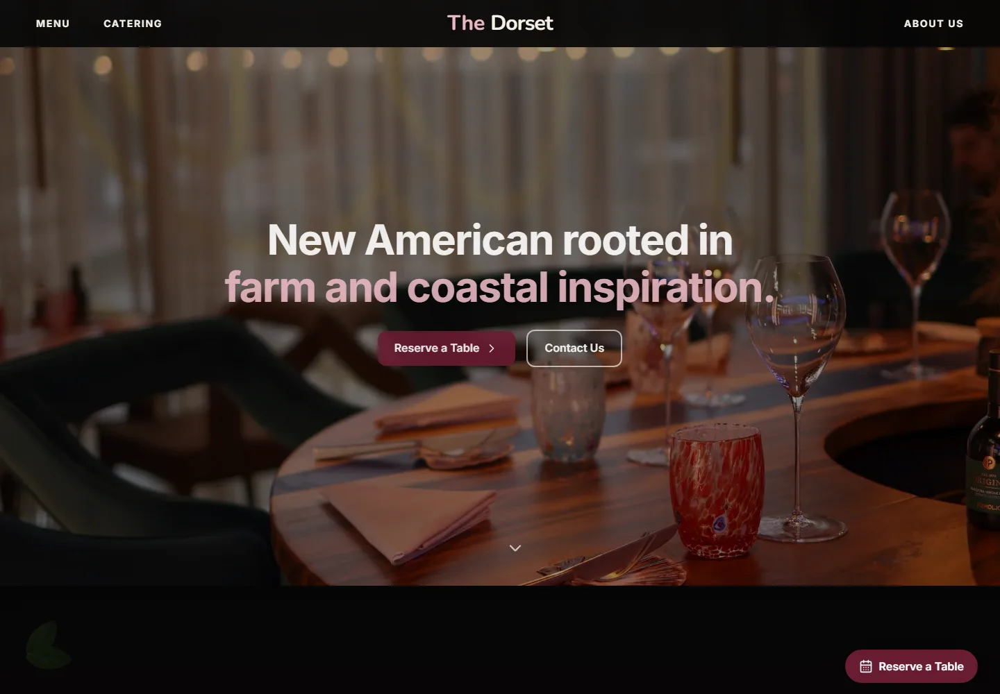
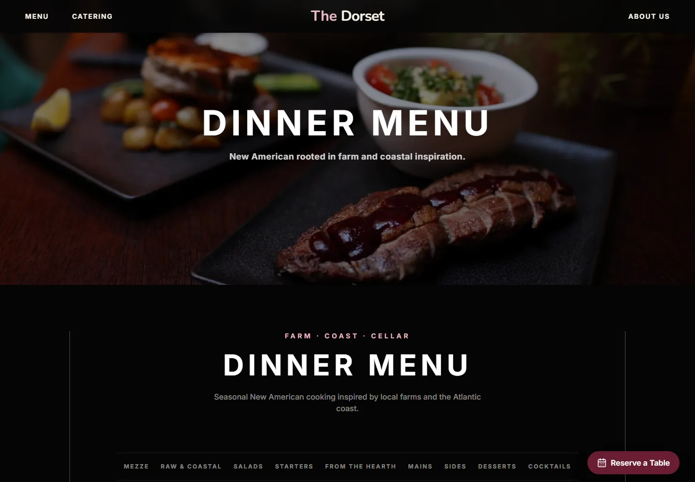

# The Dorset

The Dorset is a responsive restaurant concept website for a seasonal New American restaurant in Greenwich Village, New York City. Its visual and editorial direction is rooted in local farms, Atlantic coastal ingredients, modern hospitality, and a black, cream, and deep-burgundy palette.

This is a portfolio demonstration built by 邓钰鸣, not an operating restaurant or booking service. **Live Demo:** [dorset.affogato.xin](https://dorset.affogato.xin).

## Current pages

- **Home** — brand introduction, farm-and-coast story, signature dishes, concept guest notes, location, and contact details
- **Dinner Menu** — a text-led seasonal menu covering mezze, salads, starters, mains, sides, desserts, and cocktails
- **About** — restaurant story, philosophy, team, gallery, and visit information
- **Catering** — private-event information, media carousel, enquiries, and contact details
- **Reservations** — a portfolio-safe reservation enquiry and contact flow without a fake ordering provider

## Technology

- Next.js App Router
- React and TypeScript
- Tailwind CSS
- Framer Motion
- Netlify deployment with Deploy Previews
- Netlify Forms for contact enquiries

## Features

- Responsive navigation, menu layouts, venue galleries, and catering carousel
- Portfolio-safe reservation and contact-enquiry flows rather than a simulated checkout
- Keyboard-visible focus states, a skip link, semantic links/buttons, and reduced-motion support
- Responsive images through `next/image` plus compressed WebP venue assets
- SEO metadata, structured data, sitemap, web manifest, and social preview configuration
- Clear concept labels for fictional guest notes and non-operating restaurant status

## Screenshots

### Home



### Dinner menu



## Local development

Install dependencies and start the development server:

```bash
nvm use
npm install
npm run dev
```

Open `http://localhost:3000`.

Run the same quality checks used before a preview deploy:

```bash
npm run check
```

The project targets Node.js 20 locally and on Netlify. `npm run check` runs ESLint with the Next.js Core Web Vitals and React Hooks rules, TypeScript validation, and a production build.

## Configuration

Public brand, contact, address, hours, SEO, and structured-data values are configured through `NEXT_PUBLIC_*` environment variables. Copy `.env.example` to `.env.local`, then replace any placeholder social profiles and set the final production URL before deployment. Netlify environment-variable changes require a new deploy before they appear on the site.

The project intentionally uses `Reserve a Table` and `Contact Us` enquiry actions instead of pretending to connect to a live ordering provider.

## Content and image status

All pages follow The Dorset concept direction. Venue photographs are user-provided Palma references used only to demonstrate image selection, layout, and responsive presentation; they do not depict a real Dorset restaurant. Their provenance and usage boundary are documented in [`public/Venue/IMAGE_CREDITS.md`](public/Venue/IMAGE_CREDITS.md). Pexels food-photo credits are recorded in [`public/Signature/IMAGE_CREDITS.md`](public/Signature/IMAGE_CREDITS.md).

Fictional guest notes are labelled directly on the page. The footer also states that this is a concept portfolio project rather than an operating restaurant.

## Netlify deployment workflow

Netlify detects this Next.js project and uses its maintained Next.js runtime. The committed `netlify.toml` runs `npm run build` and publishes the generated `.next` output.

Use a preview-first workflow so routine development does not publish to the production domain:

1. Create a feature branch instead of committing routine work directly to `main`.
2. Open a pull request to receive a Netlify Deploy Preview URL.
3. Review the preview, then batch approved work into a consolidated release.
4. Merge to `main` only for the planned production releases, typically two to four times per month.

After connecting the repository in Netlify, enable **Forms > Form detection** and redeploy. The contact component submits URL-encoded data to the static `public/__forms.html` skeleton so Netlify can register and process the form. A local Next.js server does not process that endpoint; verify successful and failed submissions on a Deploy Preview before production.

Add the variables from `.env.example` in Netlify's environment-variable settings and set `NEXT_PUBLIC_SITE_URL` to the final domain so canonical URLs, social previews, the sitemap, and structured data use production addresses. Do not commit `.env.local`, `.netlify`, or credentials.

## License

Released under the [MIT License](LICENSE).
